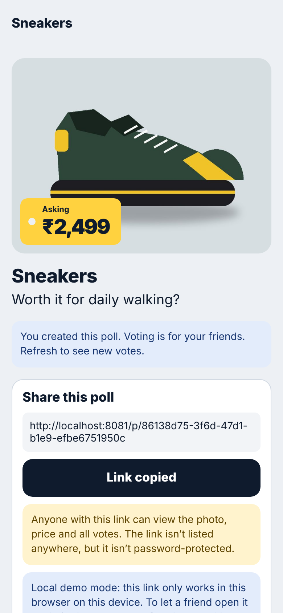

# Worth It?

A mobile-first proof of concept that answers one question: **"Is this item worth the asking price?"**
Upload a photo and a price, share an unlisted link, let a friend vote **Buy / Wait for a sale / Skip** from their phone browser (no install), then record what you decided.

Stack: Expo SDK 58, React Native, Expo Router, TypeScript. Connected version: Supabase Auth + Postgres + Storage.

 

## Two modes

| | Local demo mode (default) | Connected mode |
|---|---|---|
| Needs | Nothing | A free Supabase project + a hosted web build |
| Turned on by | Leaving `EXPO_PUBLIC_SUPABASE_*` empty | Setting both in `.env` |
| Data lives | In **this browser/app on this device only** | In Supabase |
| Share between two phones | **No.** A link only opens on the device that made it | **Yes**, if the web build is reachable by both phones |
| Demo polls | Three seeded polls; you can vote on them (stays on device) | Three seeded polls; read-only (shared data) |

The home screen shows a "Local demo mode" banner whenever Supabase is not configured.

## Run it (local demo mode)

```bash
npm install
npm run web        # browser at http://localhost:8081
npm start          # Expo dev server; press i / a, or scan the QR code with Expo Go
```

Since a second phone can't see your local data, test voting on one device with **Profile → Demo tools → Act as a new guest** and **Back to my identity**.

Open **Profile → Edit profile** to set your username, photo, and bio. The connected Feed combines polls and reels from accounts you follow. Your polls are available from your profile. Search shows recent public polls and suggested reels. Swipe in **Reels** to play a mix of discovery clips and followed accounts, roughly nine discovery reels per followed reel when both are available. Your mute choice is saved on this device. Choose **New reel** to publish an MP4 up to 20 MB. Local profiles, videos, and stars stay on the device.

Use the star on a poll or reel to add or remove your reaction. A poll gallery can mix up to 24 photos and MP4 videos. Photos keep their dimensions, are re-encoded as JPEG up to 15 MB, and open in a full-size viewer. MP4 videos can be up to 20 MB each. Paste a product URL or retailer share message into the link field to import any available gallery, name, and INR price. Each imported photo has a View product button. If a retailer makes its previews unavailable, the link can still be saved and photos can be added manually.

Expo's local development server handles previews on the same port. For release builds, run `npm run import:server` behind an HTTPS endpoint and verify that `GET /api/health` returns `{"status":"ok"}`. Set `PRODUCT_IMPORT_ORIGIN` on the importer if the web app uses a different origin.

Set the public origin in EAS before building. Replace `https://importer.example.com` with the deployed importer origin.

```sh
npx eas-cli@latest env:set --name EXPO_PUBLIC_IMPORTER_URL --value https://importer.example.com --environment preview --visibility plaintext
npx eas-cli@latest env:set --name EXPO_PUBLIC_IMPORTER_URL --value https://importer.example.com --environment production --visibility plaintext
npx eas-cli@latest build --platform android --profile production-apk
```

For a preview APK use `--profile preview`. For a local build set `EXPO_PUBLIC_IMPORTER_URL` in `.env`. Native release builds include WebView and Android sharing support. Missing importer configuration opens the on-device or manual flow.

## Share a product into Worth It on Android

The Android development build registers Worth It? for shared plain text, including product links and links inside retailer messages. A share waits for the existing sign-in or account verification flow when needed. The creator keeps one draft for shared products separately from the regular draft. Sharing the same product again reuses its existing preview or in-flight request. Sharing a different link starts a fresh shared-product draft.

Run these commands from the project folder. The Expo Build profile produces a development APK for internal installation.

```bash
npx eas-cli@latest login
npx eas-cli@latest build --platform android --profile development
npx expo start --dev-client
```

If Expo Build asks to link a cloud project, follow its prompt. If the CLI reports that it cannot write the dynamic config, add the project ID it prints under `expo.extra.eas.projectId` in `app.json`. Open the build link on the phone and install the APK. Keep Metro running and open the development server in Worth It? once before testing. The phone and the computer should be on the same network. The development server serves the existing preview API unless an alternate origin is configured.

With the Android SDK and a USB-debugging device, `npx expo run:android --device` builds and installs directly. The native share target belongs to the Worth It development APK. [Expo development builds](https://docs.expo.dev/develop/development-builds/introduction/) and [Expo Sharing for SDK 58](https://docs.expo.dev/versions/v58.0.0/sdk/sharing/)

1. Open a product in Meesho, Myntra, AJIO, or an Android browser and tap **Share → Worth It?**.
2. Check that Create opens with the link filled in. A usable preview shows the available product data and the existing **Poll**, **Compare**, and **Post** actions.
3. Repeat with Worth It in the foreground, background, and after closing it. Share the same URL while its preview is loading and confirm the app stays in one Create screen.
4. If a retailer denies automated access, confirm the link stays visible and **Try again**, **Add manually**, and **Upload photo** remain available.

## Test password reset

In Supabase, open **Authentication → URL Configuration → Redirect URLs**. The Android development app requests `worthit://auth-confirm`. For browser testing, add the exact browser origin followed by `/auth-confirm`, for example `http://localhost:8081/auth-confirm` or the callback on your deployed HTTPS site. Keep the recovery email template's `{{ .ConfirmationURL }}` link.

On the phone, install the Android development APK using **Install** on its Expo build page. On the computer, run `npx expo start --dev-client --lan`, then open Worth It on the same Wi-Fi and connect to Metro. From **Sign in → Forgot password?**, request a fresh email. Open the newest link on the device and in the app or browser that requested it. A successful link opens **Choose a new password**.

For a browser-only check on the computer, run `npm run web` and request and open the link in the same browser profile. The Expo Go LAN callback falls back to the project's Site URL on the hosted Supabase Auth service, so the password reset screen directs Expo Go testers to the development app or browser.


## Set up connected mode (needed for the real two-phone test)

1. **Create a Supabase project** at supabase.com.
2. **Configure sign-in.** In **Authentication → Sign In / Providers**, keep the Email provider enabled. Enable **Allow anonymous sign-ins** for guest polls and **Allow manual linking** so guests can turn the same identity into an email account. Keep **Confirm email** enabled for live use. Add your web app's `/auth-confirm` URL in **Authentication → URL Configuration → Redirect URLs** (for example, `http://localhost:8082/auth-confirm`). Native builds can use your configured `EXPO_PUBLIC_WEB_URL` for confirmation or an allowlisted app deep link.
3. **Create the schema.** Either paste these files, in order, into the dashboard SQL Editor:
   `supabase/migrations/0001_init.sql` (polls and storage), `supabase/migrations/0002_demo_seed.sql` (sample polls), `supabase/migrations/0003_social.sql` (profiles and reels), `supabase/migrations/0004_poll_stars_and_links.sql` (poll stars and store links), `supabase/migrations/0005_poll_media_gallery.sql` (mixed media galleries), `supabase/migrations/0006_auth_profiles.sql` (signup profiles), `supabase/migrations/0007_unique_usernames.sql` (unique usernames), and `supabase/migrations/0008_follows_and_privacy.sql` (search, follows and private accounts),
   or with the Supabase CLI: `supabase link --project-ref <ref> && supabase db push`.
   Apply only migrations that are still pending. Migration 0008 changes both media buckets to private. Release the client with signed media URLs alongside this migration so existing media continues to load. Migration `0009_comments_reel_links_notifications.sql` adds poll and reel comments, reel product links, and account activity in Notifications. Migration `0010_shopping_decisions.sql` adds question discovery, buying context, helpful vote reasons, product history, and after-buy outcomes and notifications. Migration `0011_full_size_photos.sql` raises the photo bucket limit to 15 MB. The project-wide Storage upload limit must accommodate that size.
4. **Add keys.** `cp .env.example .env` and fill in the Project URL and the **anon** key (Project Settings → API). Never put the `service_role` key in this project; nothing here needs it, and `EXPO_PUBLIC_*` values are visible to anyone who opens the app.
5. **Host the web build.** `EXPO_PUBLIC_*` values are baked in at build time, so build with them set:
   ```bash
   npm run export:web          # creates dist/
   ```
   Deploy `dist/` to any static host with a single-page-app fallback to `index.html` (so `/p/<id>` deep links work). `vercel.json` and `public/_redirects` (Netlify/Cloudflare Pages) are included. Use **https**: phone browsers only allow the clipboard and share sheet on secure origins. For a quick look without deploying, expose your dev server through an https tunnel (e.g. `cloudflared tunnel --url http://localhost:8081`) and open the tunnel URL on both phones.
   Optional: set `EXPO_PUBLIC_WEB_URL` to the public URL so links copied from the native app point at your site.

## Repeat the two-phone test

1. **Phone A:** open your hosted URL → **Ask: is it worth it?** → choose a photo, keep ₹2,499 and "Worth it for daily walking?" → **Publish poll**. Read the visibility warning, then **Copy link**.
2. Send the link to phone B (any messenger).
3. **Phone B:** open the link in the browser. No install, no sign-in. Tap **Wait for a sale**, type a reason, optionally tick "I own this item", **Submit vote**. You should see "Vote submitted" and your reason in the results. Reload: the vote form is gone (one vote per browser session).
4. **Phone A:** open the poll and tap **Refresh results** (or pull down). The vote and reason appear.
5. **Phone A:** under **Purchase update** choose **Bought**, enter the price paid, a short review and a sample store link (`https://example.com/shoes`), tick the affiliate box to see the disclosure, **Post update**.
6. **Phone B:** reload. The update is visible, with the affiliate disclosure, and there are no edit controls. (The database also refuses edits from anyone but the author; see the policy tests below.)

If phone A clears its browser data it loses guest access to its polls. **Account → Save your account** upgrades the guest to an email login to prevent that.

## Tests

```bash
npm run typecheck            # TypeScript
npm test                     # local-mode logic: seeding, one vote, author-only update, validation
```

Browser flow (local demo mode, phone-sized Chromium):
```bash
npm run export:web && npx serve -s dist -l 8081 &
pip install playwright && python -m playwright install chromium
python tests/e2e/local_flow.py http://localhost:8081 ./shots
```

SQL migrations and access policies (runs against a **throwaway plain Postgres**, using stubs for Supabase's `auth` and `storage` schemas; it never touches your project):
```bash
PGHOST=localhost PGUSER=postgres ./supabase/tests/run.sh
```
It checks: one vote per account, authors cannot vote on their own poll, visitors cannot list or read tables, only the author can write or edit a poll or purchase update, anonymous (no session) users cannot vote, `author_id`/`voter_id` never leave the database, link/price/affiliate constraints, demo polls read-only, and photo uploads limited to the uploader's own folder.

## How sharing and privacy work

- Each poll has a random UUID and a link at `/p/<uuid>`. Poll access is checked by the database. Signed-in users can find public profiles by username and see their posts. Set visibility in **Profile → Account settings → Private account**. Private profiles require an approved follow for posts and reels. Accepted followers stay approved if an account turns private. Making an account public accepts pending requests.
- Public polls can be read before sign-in and appear in Discover. The Needs an answer view prioritizes public polls with fewer written vote reasons and excludes polls with a purchase update or a reason marked helpful. Product history matches stored links exactly and displays shopper-reported prices. Buyers without an after-buy verdict see a reminder in Notifications after seven days.
- Votes are written only through `cast_vote()`, which enforces one vote per `auth.uid()` per poll.
- Photos and reels use private Storage buckets with access policies. The client requests signed media URLs that expire after ten minutes. A URL issued while someone was allowed to view a file can keep working until expiry. Photos are re-encoded in the app before upload, which removes EXIF metadata such as GPS location.
- Results and written reasons are visible to everyone with the link, including before they vote.
- Poll edit and purchase-update permissions are enforced by row-level security (`auth.uid() = author_id`), not by the UI.

## Not in this POC / known limits

- No chat, recommendations, push notifications, moderation dashboard, commission tracking or payouts. The store link and affiliate flag are display-only.
- No screen for editing a poll's question or price after publishing (the database permits it for the author). Purchase updates can be edited.
- Anonymous sign-in is rate limited by Supabase; add CAPTCHA before any public launch. Public photo uploads and reasons have no moderation.
- `get_poll_view` returns every vote in one response; fine for a POC, paginate before heavy use.
- Demo photos are bundled illustrations, not product photography. Demo names are fictional.

## Project layout

```
src/app/            routes: index (home), new, p/[id] (poll), account
src/lib/            repo interface, localRepo (device storage), supabaseRepo, validation, demo data
src/ui/             price tag, buttons, vote form, results, purchase update, share panel
supabase/migrations 0001_init.sql (schema, RLS, RPCs, storage), 0002_demo_seed.sql
supabase/tests      policy tests for plain Postgres
tests/              unit tests and browser flow
```

## Reliability, security, and performance phases

Phases 1-7 now have implementation changes: recoverable publishing/drafts, safety
and moderation, paginated feed/media caching, resumable uploads and trusted media
workers, aggregated/paged voting results, automated checks, saved polls, feedback,
and data saver settings.

**All new connected features require migrations 0012-0016.** Existing feeds, profiles, reels, poll results and notifications remain readable during rollout. CAPTCHA enforcement,
trusted worker scheduling, and media quarantine require server configuration.
No production database or deployment was changed by this implementation.

See [the release and testing guide](docs/release-and-testing.md) for phase details,
configuration, test cases, deployment requirements, and remaining verification.
Run `npm run check` and `npm run export:web` before release.

Post edit, archive/restore and permanent delete require migration **0017_post_management.sql** for connected accounts. Schedule `npm run worker:post-cleanup` on a trusted server to remove deleted uploads. See [post management setup](docs/release-and-testing.md#post-management-and-retailer-image-imports-migration-0017) for rollout instructions and verified retailer-import limitations.

Database automation is available with `npm run db:status`, the one-time `npm run db:baseline`, and `npm run db:deploy`. After private admin credentials are configured, authorized feature work can include the database deployment. See [automated database updates](docs/release-and-testing.md#automated-database-updates). Existing migrations are immutable; use `npm run db:new -- change_name` for subsequent changes.

Product extraction engine: see [architecture, retailer verification matrix, configuration and deployment](docs/product-extraction-engine.md).
