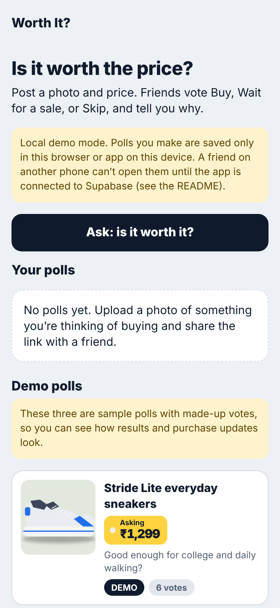

# Worth It?

A mobile-first proof of concept that answers one question: **"Is this item worth the asking price?"**
Upload a photo and a price, share an unlisted link, let a friend vote **Buy / Wait for a sale / Skip** from their phone browser (no install), then record what you decided.

Stack: Expo SDK 58, React Native, Expo Router, TypeScript. Connected version: Supabase Auth + Postgres + Storage.

 

## Two modes

| | Local demo mode (default) | Connected mode |
|---|---|---|
| Needs | Nothing | A free Supabase project + a hosted web build |
| Turned on by | Leaving `EXPO_PUBLIC_SUPABASE_*` empty | Setting both in `.env` |
| Data lives | In **this browser/app on this device only** | In Supabase |
| Share between two phones | **No.** A link only opens on the device that made it | **Yes**, if the web build is reachable by both phones |
| Demo polls | Three seeded polls; you can vote on them (stays on device) | Three seeded polls; read-only (shared data) |

The home screen shows a "Local demo mode" banner whenever Supabase is not configured.

## Run it (local demo mode)

```bash
npm install
npm run web        # browser at http://localhost:8081
npm start          # Expo dev server; press i / a, or scan the QR code with Expo Go
```

Since a second phone can't see your local data, test voting on one device with **Demo tools** (bottom of the home screen) → "Act as a new guest" (you become a different voter) and "Back to my identity".

## Set up connected mode (needed for the real two-phone test)

1. **Create a Supabase project** at supabase.com.
2. **Allow guests.** In the dashboard, Authentication → Sign In / Providers → turn on **Allow anonymous sign-ins**. Each browser gets a real guest `auth.uid()`, which is what enforces "one vote per guest session per poll". (Menu labels change over time; look for "anonymous".) For the optional "Save your account" screen, also keep the Email provider on; for a quick POC, turn off "Confirm email".
3. **Create the schema.** Either paste these two files, in order, into the dashboard SQL Editor:
   `supabase/migrations/0001_init.sql` (tables, access policies, functions, photo bucket and storage policies) then `supabase/migrations/0002_demo_seed.sql` (three demo polls),
   or with the Supabase CLI: `supabase link --project-ref <ref> && supabase db push`.
4. **Add keys.** `cp .env.example .env` and fill in the Project URL and the **anon** key (Project Settings → API). Never put the `service_role` key in this project; nothing here needs it, and `EXPO_PUBLIC_*` values are visible to anyone who opens the app.
5. **Host the web build.** `EXPO_PUBLIC_*` values are baked in at build time, so build with them set:
   ```bash
   npm run export:web          # creates dist/
   ```
   Deploy `dist/` to any static host with a single-page-app fallback to `index.html` (so `/p/<id>` deep links work). `vercel.json` and `public/_redirects` (Netlify/Cloudflare Pages) are included. Use **https**: phone browsers only allow the clipboard and share sheet on secure origins. For a quick look without deploying, expose your dev server through an https tunnel (e.g. `cloudflared tunnel --url http://localhost:8081`) and open the tunnel URL on both phones.
   Optional: set `EXPO_PUBLIC_WEB_URL` to the public URL so links copied from the native app point at your site.

## Repeat the two-phone test

1. **Phone A:** open your hosted URL → **Ask: is it worth it?** → choose a photo, keep ₹2,499 and "Worth it for daily walking?" → **Publish poll**. Read the visibility warning, then **Copy link**.
2. Send the link to phone B (any messenger).
3. **Phone B:** open the link in the browser. No install, no sign-in. Tap **Wait for a sale**, type a reason, optionally tick "I own this item", **Submit vote**. You should see "Vote submitted" and your reason in the results. Reload: the vote form is gone (one vote per browser session).
4. **Phone A:** open the poll and tap **Refresh results** (or pull down). The vote and reason appear.
5. **Phone A:** under **Purchase update** choose **Bought**, enter the price paid, a short review and a sample store link (`https://example.com/shoes`), tick the affiliate box to see the disclosure, **Post update**.
6. **Phone B:** reload. The update is visible, with the affiliate disclosure, and there are no edit controls. (The database also refuses edits from anyone but the author; see the policy tests below.)

If phone A clears its browser data it loses guest access to its polls. **Account → Save your account** upgrades the guest to an email login to prevent that.

## Tests

```bash
npm run typecheck            # TypeScript
npm test                     # local-mode logic: seeding, one vote, author-only update, validation
```

Browser flow (local demo mode, phone-sized Chromium):
```bash
npm run export:web && npx serve -s dist -l 8081 &
pip install playwright && python -m playwright install chromium
python tests/e2e/local_flow.py http://localhost:8081 ./shots
```

SQL migrations and access policies (runs against a **throwaway plain Postgres**, using stubs for Supabase's `auth` and `storage` schemas; it never touches your project):
```bash
PGHOST=localhost PGUSER=postgres ./supabase/tests/run.sh
```
It checks: one vote per account, authors cannot vote on their own poll, visitors cannot list or read tables, only the author can write or edit a poll or purchase update, anonymous (no session) users cannot vote, `author_id`/`voter_id` never leave the database, link/price/affiliate constraints, demo polls read-only, and photo uploads limited to the uploader's own folder.

## How sharing and privacy work

- Each poll has a random UUID; the link is `/p/<uuid>`. Tables are **not** publicly readable. Visitors read a poll only through the `get_poll_view(id)` function, so there is no way to list other people's polls.
- Votes are written only through `cast_vote()`, which enforces one vote per `auth.uid()` per poll.
- Photos go to a public Storage bucket under `<user id>/<random>.jpg`. **Anyone who has the link can see the photo**; the author is told this on the create screen and the share panel. Photos are re-encoded in the app before upload, which removes EXIF metadata such as GPS location.
- Results and written reasons are visible to everyone with the link, including before they vote.
- Poll edit and purchase-update permissions are enforced by row-level security (`auth.uid() = author_id`), not by the UI.

## Not in this POC / known limits

- No chat, recommendations, push notifications, moderation dashboard, commission tracking or payouts. The store link and affiliate flag are display-only.
- No screen for editing a poll's question or price after publishing (the database permits it for the author). Purchase updates can be edited.
- Anonymous sign-in is rate limited by Supabase; add CAPTCHA before any public launch. Public photo uploads and reasons have no moderation.
- `get_poll_view` returns every vote in one response; fine for a POC, paginate before heavy use.
- Demo photos are bundled illustrations, not product photography. Demo names are fictional.

## Project layout

```
src/app/            routes: index (home), new, p/[id] (poll), account
src/lib/            repo interface, localRepo (device storage), supabaseRepo, validation, demo data
src/ui/             price tag, buttons, vote form, results, purchase update, share panel
supabase/migrations 0001_init.sql (schema, RLS, RPCs, storage), 0002_demo_seed.sql
supabase/tests      policy tests for plain Postgres
tests/              unit tests and browser flow
```
